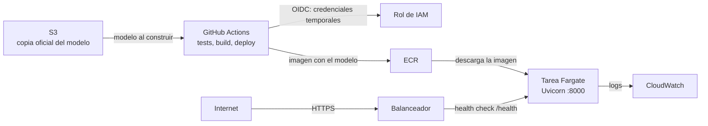

# Credit risk — Give Me Some Credit

Modelo de probabilidad de **mora severa (90+ días en los próximos 2 años)** servido por una API
que devuelve probabilidad, nivel de riesgo, decisión sugerida y razones principales.
Contexto de negocio: [docs/business_context.md](docs/business_context.md).

## Inicio rápido

Requisitos: [uv](https://docs.astral.sh/uv/).

```bash
uv sync
uv run pre-commit install
uv run poe check      # lint + tests
```

### Datos

Descarga `cs-training.csv`, `cs-test.csv`, `sampleEntry.csv` y `Data Dictionary.xls` desde
[Kaggle — Give Me Some Credit](https://www.kaggle.com/c/GiveMeSomeCredit/data) y colócalos en
`data/raw/`. Los datos no se versionan.

## Estructura

```
configs/params.yaml        parámetros (semilla, rutas, costos)
src/credit_risk/           paquete: config, data, features, models, evaluation, decision, monitoring, api, deploy
deploy/aws/                scripts de despliegue en AWS, uno por paso
tests/                     tests (pytest)
notebooks/                 exploración (la lógica vive en src/)
data/{raw,interim,processed,external}/   datos locales, no versionados
docs/                      negocio, constitución, diccionario, ADRs, specs y planes
```

## Cómo se trabaja

Desarrollo guiado por specs con IA: cada sub-proyecto tiene spec → plan → implementación,
trazable en `git log`. Reglas para agentes en [AGENTS.md](AGENTS.md); principios en
[docs/constitution.md](docs/constitution.md); uso de IA en [docs/ai_usage_log.md](docs/ai_usage_log.md).

## API

Requisito: haber entrenado el modelo (`uv run poe train`), que genera `models/champion.joblib`.

```bash
uv run poe serve        # http://127.0.0.1:8000
```

Abre `http://127.0.0.1:8000/docs`. Guion de la demo:

1. `GET /health`: la API está viva y el modelo cargado.
2. `POST /predict` con el ejemplo `low_risk` → `approve`, probabilidad 0.0089 (bajo riesgo) y 3 razones.
3. `POST /predict` con `same_client_with_delays` (2 atrasos de 30–59 días y tarjeta al 95 %) → `reject`, probabilidad 0.1728; las razones pasan a ser los atrasos y el uso de la tarjeta.
4. `POST /predict` con `invalid_age` (`age: 10`) → 422 con el detalle del campo, sin llegar al modelo.

| Endpoint | Qué hace |
|---|---|
| `GET /health` | Estado y versión del modelo (503 si no está cargado) |
| `POST /predict` | Probabilidad, decisión (`approve`/`review`/`reject`), nivel de riesgo y 3 razones |
| `GET /model-info` | Versión, umbrales, costos, métricas de test y variables |

**Cómo leer la respuesta:**
- `MonthlyIncome` y `NumberOfDependents` son opcionales: si no se envían (o llegan como `null`), el pipeline los imputa igual que en el entrenamiento.
- Los campos numéricos deben ir como números JSON: `"30"` (texto) o `true` se rechazan con 422.
- Las **razones** son las variables que más suben el riesgo de ese cliente según SHAP, promediado sobre las 5 copias calibradas del modelo. Indican **dirección y orden**, no cuántos puntos de probabilidad aporta cada una (SHAP se calcula antes de la calibración isotónica).
- Latencia medida en local: unos 100 ms por predicción, con los explicadores SHAP creados una sola vez al cargar el modelo.

## Despliegue

La API se publicó en AWS con HTTPS mediante **ECS Express Mode** (Fargate + balanceador) y se
despliega desde GitHub Actions **sin claves de AWS guardadas** (OIDC). Por costo, la
infraestructura solo existe mientras se prueba: se crea con los scripts y se elimina después, así
que no hay una URL pública permanente. Por qué esta plataforma:
[ADR-003](docs/decisions/ADR-003-plataforma-despliegue.md).



### Requisitos

Docker, [AWS CLI v2](https://docs.aws.amazon.com/cli/) con una sesión iniciada, bash (en Windows,
Git Bash) y `models/champion.joblib` entrenado. Región: `us-east-1`. Los nombres de los recursos
están en [deploy/aws/config.sh](deploy/aws/config.sh); ningún script lleva cuentas ni claves.

### Fase 1: Docker en local

```bash
uv run poe docker-build   # etiqueta la imagen con el SHA del commit y la versión del modelo
uv run poe docker-run     # http://localhost:8000/docs
uv run python -m credit_risk.deploy.smoke --url localhost:8000
```

La imagen corre como usuario sin privilegios y no incluye `data/` ni los modelos candidatos.

### Fase 2: AWS

```bash
bash deploy/aws/00_budget.sh tu_correo@ejemplo.com   # alerta de 5 USD, antes que nada
bash deploy/aws/01_bucket_and_model.sh               # S3: copia oficial del modelo
bash deploy/aws/03_roles.sh                          # roles de ejecución e infraestructura
bash deploy/aws/02_ecr_push.sh                       # imagen en ECR, con escaneo
bash deploy/aws/04_service.sh                        # servicio y URL pública (5-20 min)
bash deploy/aws/05_smoke.sh                          # smoke test contra la URL
```

Si el smoke test devuelve 503 en todo, incluida la edad inválida, el balanceador aún no envía
tráfico a la tarea: hay que esperar 2 o 3 minutos y repetirlo.

### Fase 3: GitHub Actions

1. `bash deploy/aws/06_github_oidc.sh` crea el proveedor OIDC y un rol que solo puede asumir la
   rama `main` de este repositorio, con permisos limitados al bucket, al repositorio de ECR y al
   servicio.
2. En GitHub, crea la variable de repositorio `AWS_ROLE_ARN` con el ARN que imprime el script.
3. Con la infraestructura creada, lanza **Actions → Deploy → Run workflow**: tests → OIDC →
   modelo de S3 → imagen a ECR → actualización del servicio → smoke test.

El workflow es manual porque la infraestructura no existe de forma permanente. El CI de lint y
tests corre en cada `push`.

### Costo y limpieza

Unos **0,06 USD por hora** (estimación) mientras el servicio existe, sobre todo por el balanceador,
Fargate y las IP públicas. S3 y ECR cuestan céntimos al mes.

```bash
bash deploy/aws/99_teardown.sh
```

Elimina todo menos la alerta de presupuesto, que es gratis, y pregunta a cada servicio si queda
algo. El índice de etiquetas de AWS puede seguir listando recursos ya borrados durante horas; por
eso la verificación directa es la que cuenta.

### Resultados medidos

| Medida | Valor |
|---|---|
| Imagen | 330 MB comprimida; 896 MB sin comprimir son dependencias de Python |
| Despliegue completo desde GitHub Actions | 12 min 29 s, de ellos 10 min 43 s de despliegue canary |
| Latencia media de `/predict` desde GitHub Actions | 229 ms |
| Latencia media de `/predict` desde una conexión doméstica | 464 ms |

El escaneo básico de ECR no reportó vulnerabilidades críticas. En la primera imagen analizada, las
4 de severidad alta estaban en paquetes de Debian de la imagen base. Se mitigan reconstruyendo la
imagen con la base actualizada.

### ¿Cómo se desplegaría en producción?

- **Infraestructura como código** (Terraform o CDK) en lugar de scripts.
- **Entornos separados** de desarrollo y producción, con aprobación antes de producción.
- **Al menos 2 tareas** en zonas de disponibilidad distintas, con autoescalado ajustado a carga real.
- **Autenticación** y límites de uso en la API; hoy es pública porque es una demo.
- **Monitoreo del modelo**: deriva de datos y de la tasa de mora, además de las alarmas técnicas.
- **Registro de modelos** con aprobación y trazabilidad entre modelo, datos e imagen.
- **Regla en el pipeline** que bloquee el despliegue si aparecen vulnerabilidades críticas.
- **SageMaker** como alternativa si el equipo opera muchos modelos.

## Estado

| # | Sub-proyecto | Estado |
|---|---|---|
| 0 | Cimientos | ✅ |
| 1 | Datos + EDA | ✅ |
| 2 | Modelado | ✅ (hecho junto con el 3) |
| 3 | Política de decisión | ✅ (hecho junto con el 2) |
| 4 | API | ✅ |
| 5 | Despliegue en AWS | ✅ |
| 6 | Monitoreo | pendiente |
